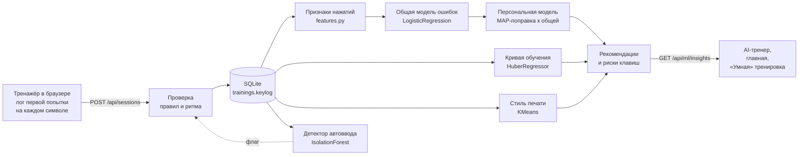

# Печать героя

**Веб-тренажёр слепой печати, который превращает обучение в игру и сам подбирает, что тренировать.**
Игрок печатает слова, предложения, код или символы. Тренажёр в реальном времени считает скорость
и точность, подсвечивает нужный палец, начисляет очки с комбо-множителями, открывает уровни,
режимы и достижения. AI-тренер учится на каждом нажатии и подсказывает, где игрок ошибётся
в следующий раз и как быстро будет печатать через неделю.

Проект для хакатона «Киберрывок 2026», отборочный этап, кейс «Печать героя».

> **Жюри:** пошаговый запуск, сценарий проверки и соответствие ТЗ — в [JURY.md](JURY.md).

**Коротко о главном**

- 7 режимов: слова, предложения, код (Python / JavaScript / HTML / CSS), символы, «Умная» тренировка от AI,
  свой текст и испытание дня — один текст для всех игроков; русская и английская раскладки.
- Экранная клавиатура со схемой рук: следующая клавиша и нужный Shift подсвечены цветом пальца.
- Геймификация: очки, комбо ×2 / ×3 / ×5, случайные бонусы, уровни с восемью званиями,
  27 достижений, задания дня, серия дней, эффекты и звуки.
- Статистика с графиками, тепловой картой ошибок и разбором трудных букв и сочетаний.
- Аккаунты, синхронизация между устройствами, таблица лидеров по пяти метрикам.
- **AI-тренер на scikit-learn**: модель ошибок (общая и персональная), прогноз роста скорости,
  стиль печати, детектор автоматического ввода, рекомендации и «Умная» тренировка.
- Тёмная и светлая темы, адаптивная вёрстка от 375 px, работа без сборки и без внешних сервисов.

**Содержание**

1. [Быстрый старт](#быстрый-старт)
2. [О продукте](#о-продукте)
3. [Экраны](#экраны)
4. [Как работает тренажёр](#как-работает-тренажёр)
5. [Геймификация в цифрах](#геймификация-в-цифрах)
6. [AI-тренер: машинное обучение](#ai-тренер-машинное-обучение)
7. [Структура и архитектура](#структура)
8. [API](#api)
9. [Тесты](#тесты)

## Быстрый старт

Самый простой путь: **`run.bat`** на Windows (двойной щелчок) или **`sh run.sh`** на macOS и Linux.
При первом запуске скрипт создаст окружение и поставит зависимости, затем запустит сервер.

Вручную: нужен Python 3.10+. Фронтенд собирать не нужно: бэкенд раздаёт его как статику, всё приложение
работает на одном порту.

```bash
python -m venv .venv
.venv\Scripts\activate            # macOS / Linux: source .venv/bin/activate
pip install -r backend/requirements.txt
uvicorn backend.main:app
```

Откройте <http://127.0.0.1:8000>. База SQLite создаётся сама в `data/pechat.db`, при первом
запуске в неё добавляются демо-соперники для таблицы лидеров. Документация API — <http://127.0.0.1:8000/api/docs>.

Чтобы быстро увидеть всё приложение: **Профиль → Демо и данные**. Там можно открыть все режимы
без прокачки уровня и заполнить историю за четыре недели (с логами нажатий), чтобы появились
графики, тепловая карта и выводы AI-тренера.

**Без бэкенда.** Фронтенд можно открыть и любым статическим сервером, например
`python -m http.server 5173 --directory frontend`. Тогда он не найдёт `/api` и переключится на
локальный мок (`js/api/mock.js`): прогресс хранится только в localStorage этого браузера,
а в рейтинге — демо-соперники.

## О продукте

### Проблема

Слепой печати учатся многие, но бросают почти все. Классические тренажёры — это длинные
однообразные упражнения, сухие цифры в конце и никакого понимания, что именно мешает
печатать быстрее. Мотивация заканчивается раньше, чем появляется навык.

### Решение

«Печать героя» сочетает три вещи:

1. **Правильную методику.** Постановка пальцев на основной ряд, подсветка нужного пальца
   на каждой клавише, строгий режим, где ошибку нельзя «проскочить», и подсказки по технике.
2. **Игру, которая держит.** Каждое верное нажатие приносит очки, серия без ошибок разгоняет
   множитель до ×5, а уровни, достижения, ежедневные задания, серия дней и рейтинг дают
   причину вернуться завтра.
3. **Персонального тренера.** Модели машинного обучения находят слабые места конкретного
   игрока: клавиши, переходы между пальцами, Shift, темп, усталость. Тренер прогнозирует рост
   скорости и сам подбирает упражнение.

### Для кого

- Школьники и студенты, которые хотят печатать быстрее для учёбы.
- Программисты: отдельный режим с фрагментами кода и спецсимволами `( ) { } [ ] < > ; : $`.
- Все, кто много работает с текстом и хочет перестать смотреть на клавиатуру.

### Путь игрока

1. Открывает сайт и сразу тренируется как гость: регистрация не нужна.
2. Видит на клавиатуре, каким пальцем нажимать, а над текстом — живые скорость, точность и комбо.
3. После упражнения получает оценку S–D, опыт, награды, разбор ошибок и график скорости.
4. Регистрируется: прогресс гостя переносится в аккаунт и доступен с любого устройства.
5. Через несколько тренировок AI-тренер находит его слабые места и предлагает «Умную» тренировку.
6. Каждый день возвращается за заданиями, серией дней и испытанием дня, соревнуется в рейтинге.

## Экраны

| Экран | Что на нём |
|---|---|
| **Главная** | приветствие и звание; следующая тренировка с лучшим результатом в режиме; кольцо уровня с опытом; серия дней с отметками недели; цель дня (минуты практики); три задания дня с наградами; рекомендация AI-тренера; испытание дня; карточки режимов с замками по уровню; последние тренировки со спарклайном скорости; ближайшие достижения с прогрессом |
| **Тренировка** | панель режимов (режим, язык или язык кода, сложность, режим ошибок, длительность); HUD: таймер, зн/мин, сл/мин, точность, ошибки, комбо-метр и очки; поле печати на три строки (код — на шесть) с плавной кареткой и прокруткой; активные бонусы; экранная клавиатура и схема рук; совет по технике |
| **Итоги** | оценка S–D, скорость, точность, ошибки, лучшая серия, очки, бонусы; бонус за упражнение; разбор ошибок (начало / середина / конец, исправленные и пропущенные, время на символ, ошибки по рядам); график скорости по секундам; опыт с анимацией повышения уровня; новые достижения; трудные символы |
| **AI-тренер** | вкладка «Мои данные»: рекомендации, тепловая карта прогноза ошибок, факторы риска «вы против всех», прогноз скорости с коридором, стиль печати на радаре, ритм по пальцам, трудные переходы. Вкладка «Все игроки»: размер выборки и качество моделей, общие закономерности, самые трудные клавиши, средняя кривая обучения, группы стилей, описание методов |
| **Статистика** | период 7 / 30 дней / всё время; KPI с динамикой к прошлому периоду; графики скорости (средняя и лучшая за день) и точности; тепловая карта ошибок на клавиатуре RU/EN; трудные символы и сочетания с трендом; календарь активности за полгода; история тренировок |
| **Рейтинг** | метрики: скорость, точность, опыт, серия, испытание дня; периоды: сегодня, неделя, всё время; пьедестал топ-3, таблица до 50 мест, ваше место и отставание от игрока выше |
| **Достижения** | коллекция из 27 наград четырёх редкостей с прогрессом и датой получения, фильтры, опыт за награды |
| **Профиль** | имя, звание, уровень, ключевые цифры (тренировки, время, рекорд, лучшая точность, награды, опыт); слабые символы; открытые режимы; календарь занятий; настройки: тема, эффекты, размер текста, звук и громкость, клавиатура, схема рук, цель дня; синхронизация; демо-данные и сброс |
| **Вход** | вход и регистрация по email, вход через VK ID, Яндекс, Google, GitHub (демо), продолжение без аккаунта |

## Как работает тренажёр

### Обработка ввода

Движок (`frontend/js/game/engine.js`) не знает о DOM и получает символы от страницы тренажёра:

1. Текст хранится как массив символов, включая пробелы и переводы строк. Есть указатель текущей позиции.
2. Нажатие сравнивается с ожидаемым символом. Модификаторы учтены: заглавная буква или знак — это
   уже другой символ, и клавиатура подсвечивает нужный Shift мизинцем противоположной руки.
3. **Верно**: символ зеленеет, указатель сдвигается, растёт серия и начисляются очки.
4. **Неверно**: фиксируется ошибка, символ краснеет, над ним видно нажатое, серия сбрасывается
   (если не сработал бонус «Щит»), звучит сигнал, поле вздрагивает.
   - В **строгом** режиме (по умолчанию, как в ТЗ) курсор ждёт верную клавишу.
   - В **свободном** курсор идёт дальше, а Backspace возвращает назад для исправления.
5. Служебные клавиши игнорируются. `Esc` перезапускает упражнение, `Tab` даёт новый текст.
6. Если раскладка не совпадает с языком текста (печатаете латиницей в русском упражнении),
   нажатие не считается ошибкой, а появляется подсказка переключить раскладку.
7. В коде отступ после Enter пропускается автоматически.
8. При потере фокуса тренировка встаёт на паузу, время не идёт.
9. Упражнение заканчивается по таймеру или в конце текста. Итог уходит на сервер, сервер проверяет
   правдоподобность и начисляет опыт.

Ввод с экранной клавиатуры телефона и через IME тоже поддерживается: текст приходит через событие
`input` скрытого поля.

### Состояния символа

| Состояние | Как выглядит | Когда |
|---|---|---|
| Ожидает | приглушённый | ещё не введён; текущий символ и текущее слово ярче |
| Правильный | зелёный | введён верно с первой попытки |
| Исправленный | янтарный | была ошибка, потом введён верно |
| Ошибка | красный фон, над буквой — нажатый символ | неверное нажатие |
| Пропущен | остаётся красным | свободный режим: ошибка не исправлена до конца текста |
| Автоотступ | бледный | пробелы отступа в коде после Enter |

### Метрики

```
зн/мин   CPM = верные символы / минуты
сл/мин   WPM = CPM / 5
точность       = верные нажатия / все нажатия × 100%
```

Плюс посекундные замеры (средняя и мгновенная скорость), лог первой попытки на каждой
позиции для AI-тренера, статистика ошибок по символам и парам символов.

### Тексты

- **Слова**: словарь из ~360 русских и ~220 английских слов, фильтр по длине под сложность
  (2–5, 3–7, 4–9, 5–10 букв), на высоких сложностях — заглавные и знаки препинания.
- **Предложения**: авторские предложения на русском и английском, на сложности «Легенда» — с цифрами и знаками.
- **Код**: фрагменты на Python, JavaScript, HTML и CSS трёх уровней вложенности.
- **Символы**: группы из букв, цифр, знаков препинания, скобок и спецсимволов; набор растёт со сложностью
  и учитывает, что есть на русской раскладке.
- **Свой текст**: типографские кавычки, тире и многоточия заменяются на набираемые, лишние символы убираются.
- **Испытание дня**: три предложения, выбранные генератором с зерном из даты, — одинаковые у всех.

Перемешивание — алгоритм Фишера — Йетса. В режимах на время текст бесконечный: следующий кусок
дописывается, когда до конца остаётся 60 символов.

## Геймификация в цифрах

### Очки и комбо

```
P = C · M + B
C — правильные символы (по 10 очков), M — множитель комбо, B — бонус за упражнение
```

| Серия без ошибок | Множитель | Состояние |
|---|---|---|
| 0–9 | ×1 | без комбо |
| 10–24 | ×2 | «Разогрев» |
| 25–49 | ×3 | «В ударе» |
| 50+ | ×5 | «В огне»: огненный режим, угольки, свечение поля |

Бонус за упражнение: +100 очков за завершение и ещё +75 при точности от 95% или +150 при точности от 98%.

### Случайные бонусы

Выпадают с вероятностью 0,7% на верное нажатие при серии от 10, не чаще раза в 9 секунд.

| Бонус | Эффект |
|---|---|
| Двойной опыт | ×2 опыта на 10 секунд |
| Огненный рывок | +50% очков на 15 секунд |
| Щит комбо | следующая ошибка не сбросит серию (до 30 секунд) |
| Песочные часы | +5 секунд к таймеру (в режимах на время) |

### Опыт, уровни и звания

```
опыт за упражнение = очки (с учётом ×2 опыта) / 50 × k,   k = 1,25 при точности ≥ 97%, 1,1 при ≥ 93%, 1 при ≥ 85%, иначе 0,75
опыт до уровня L   = 50 · (L − 1) · L   →   0, 100, 300, 600, 1000, …
```

| Уровень | Звание | Что открывается |
|---|---|---|
| 1 | Новобранец | Слова, Предложения, Умная, Свой текст; сложность «Новичок» |
| 2 | | режим «Символы» |
| 3 | Ученик | сложность «Боец» |
| 4 | | режим «Код» |
| 5 | Оруженосец | |
| 6 | | сложность «Ветеран» |
| 8 | Рыцарь клавиш | |
| 10 | | сложность «Легенда» |
| 12 / 16 / 20 / 30 | Мастер слова / Грандмастер / Герой печати / Легенда | |

Опыт также дают задания дня и достижения.

### Оценка за упражнение

| Оценка | Условие |
|---|---|
| S | точность ≥ 98% и скорость ≥ 250 зн/мин |
| A | точность ≥ 95% и скорость ≥ 180 |
| B | точность ≥ 92% и скорость ≥ 120 |
| C | точность ≥ 85% |
| D | остальное |

### Задания дня

Каждый день — три задания из девяти, одинаковые у всех игроков (выбор детерминирован датой)
и только из открытых режимов: 3 тренировки (60 XP), 1500 символов (50), серия 60 (50),
точность 97% (50), 8 минут практики (60), скорость 180 зн/мин (60), упражнение «Символы» (40),
упражнение «Код» (45), 2 бонуса (40).

### Достижения

| Редкость (опыт) | Достижения |
|---|---|
| Обычные (+25) | Первые шаги — первая тренировка · Разминка — 10 тренировок · Скорость звука — 200 зн/мин · В огне — комбо ×5 · Десять тысяч — 10 000 символов · Привычка — 3 дня подряд · Везунчик — 10 бонусов · Оруженосец — 5 уровень |
| Редкие (+75) | Молния — 300 зн/мин · Чистый лист — 100% точности от 100 символов · Огненный шторм — серия 300 · Марафонец — 1 час практики · Полиглот — русский и английский · Кодер — режим «Код» · Шифровальщик — «Символы» от 95% · Неделя огня — 7 дней подряд · Ночная сова — тренировка с 0 до 5 часов · Ранняя пташка — с 5 до 8 часов · Ветеран — 10 уровень |
| Эпические (+200) | Стальной палец — 1000 нажатий подряд без ошибок · Снайпер — 5 тренировок подряд от 98% · Ураган — 450 зн/мин · Чистый код — «Код» без ошибок · Летописец — 100 000 символов |
| Легендарные (+500) | Печатный гений — 300 сл/мин · Несгибаемый — 30 дней подряд · Герой печати — 20 уровень |

### Обратная связь

Искры у каретки (сильнее с ростом комбо), взрыв частиц и крупная надпись на смене множителя,
огненный режим на ×5, конфетти на новом уровне и редких наградах, всплывающие уведомления
о достижениях, синтезированные звуки клавиш, ошибки, комбо и фанфары (WebAudio, без файлов).
Эффекты можно ослабить или выключить; настройка `prefers-reduced-motion` в системе отключает анимации.

## Статистика, аккаунты и рейтинг

- **Статистика**: всё считается из истории тренировок в базе. Разбор трудных символов учитывает
  давность (вес 0,5 каждые 14 дней), сглаживает долю ошибок байесовским априорным распределением
  и ранжирует по нижней границе доверительного интервала (подробности — в разделе «Анализ трудных символов»).
- **Аккаунты**: email и пароль (хэш scrypt), сессия в httpOnly-cookie, гостевой режим без регистрации.
  При регистрации прогресс гостя переносится в аккаунт. Вход с любого устройства возвращает тот же прогресс.
- **Рейтинг**: строится одним SQL-запросом по таблице тренировок. Метрики — лучшая скорость,
  средняя точность, опыт, самая длинная серия и лучший результат испытания дня (при точности от 90%).
  Результаты с подозрительным ритмом в рейтинг не попадают.

## Интерфейс и дизайн

- **Две темы**: тёмная «кузница» и светлая «пергамент», плюс режим «как в системе».
  Все цвета — CSS-переменные в `css/tokens.css`; canvas-эффекты и графики читают цвета из темы.
- **Шрифты**: Unbounded для заголовков и цифр, Manrope для интерфейса, JetBrains Mono для текста упражнения.
- **Цвета пальцев** одинаковы на клавиатуре, схеме рук и графиках ритма.
- **Адаптивность**: от 375 px. На планшете сайдбар сворачивается в иконки, на телефоне становится нижней панелью.
- **Доступность**: видимый фокус, подписи для экранных чтецов, управление с клавиатуры.
- **Производительность**: нажатие меняет классы одного-двух элементов и позицию каретки, а не перерисовывает
  текст. Скорость пересчитывается по таймеру. Частицы — один canvas с пулом до 480 штук, анимация крутится,
  только пока частицы есть. Графики уничтожаются при уходе со страницы.

## AI-тренер: машинное обучение

Главная идея: тренажёр не просто считает ошибки, а **учится на каждом нажатии** и отвечает
на три вопроса: где вы ошибётесь в следующий раз, как быстро вы будете печатать через неделю
и что тренировать прямо сейчас. Модели работают на двух уровнях одновременно:

- **по всем игрокам** — общие закономерности: какие клавиши и движения трудны для всех,
  как в среднем растёт скорость, какие бывают стили печати;
- **по одному игроку** — персональная модель ошибок, прогноз именно вашей скорости,
  ваш стиль относительно остальных и рекомендации.

Модели обучаются на сервере (`backend/ml/`, scikit-learn) по данным из SQLite, результаты
отдаёт `GET /api/ml/insights`, а показывает страница **AI-тренер** (вкладки «Мои данные» и «Все игроки»),
карточка рекомендации на главной и режим **«Умная»** в тренажёре.

### Конвейер



| Уровень | Что обучается | На каких данных | Где видно |
|---|---|---|---|
| Все игроки | общая модель ошибок, средняя кривая обучения, группы стилей, детектор автоввода | все тренировки в базе | AI-тренер → «Все игроки», честный рейтинг |
| Один игрок | персональная модель ошибок, прогноз скорости, место среди стилей, ритм по пальцам, рекомендации | тренировки этого игрока + общие модели как априорное знание | AI-тренер → «Мои данные», главная, режим «Умная» |

### Данные: лог нажатий

Движок тренажёра (`frontend/js/game/engine.js`) пишет для каждой позиции текста первую попытку:

```json
"keylog": { "t": [0, 182, 351, 540], "ch": "дом ", "err": "0010" }
```

`t` — миллисекунды от старта, `ch` — какой символ нужно было нажать, `err` — ошибся ли игрок
с первой попытки. Лог уходит на сервер вместе с итогом тренировки, проходит проверку
(длина, монотонность времени, согласованность с числом ошибок) и хранится в `trainings.keylog`.
Из одной минутной тренировки получается 150–400 обучающих примеров.

### Признаки нажатия (`backend/ml/features.py`)

Каждое нажатие превращается в вектор признаков. Работаем с **физическими клавишами**, а не с буквами:
«ф» и «a» — это одна клавиша KeyA и одно движение пальца, поэтому навык с одной раскладки помогает
предсказывать ошибки на другой, а общая модель учится сразу на русских и английских текстах.

| Признак | Что означает |
|---|---|
| `shift` | нужен Shift: заглавная буква или знак |
| `same_finger` | тот же палец, что на прошлом символе, но другая клавиша |
| `same_key` | повтор той же клавиши |
| `hand_alt` | смена руки относительно прошлого символа |
| `row_jump` | через сколько рядов прыгает палец (0–3) |
| `word_start` | первая буква слова |
| `symbol` | цифра или знак препинания |
| `tempo` | −ln(интервал / ваша медиана): насколько нажатие быстрее вашего обычного темпа |
| `fatigue` | доля пройденной тренировки: 0 — начало, 1 — конец |
| one-hot клавиши | собственная трудность каждой из 49 клавиш |

Раскладки, пальцы и ряды описаны в `backend/ml/layout.py` (порт `frontend/js/data/layouts.js`).

### 1. Модель ошибок: где вы ошибётесь

`backend/ml/error_model.py`. Предсказывает вероятность ошибки на нажатии:

```
P(ошибка) = σ(w · x + b),   σ(z) = 1 / (1 + e^(−z))
```

**Общая модель** — `sklearn.linear_model.LogisticRegression` на нажатиях всех игроков
(до 3000 последних тренировок с логом). Качество — ROC AUC на 20% тренировок,
отложенных до обучения (на демо-базе ≈ 0,67; 0,5 — случайное угадывание).

**Персональная модель** — та же логистическая регрессия, но с априорным распределением
вокруг общей модели (MAP-оценка, иерархический байесовский подход):

```
β_вы = argmin  −log L(β | ваши нажатия) + λ/2 · ‖β − β_все‖²,   λ = 4
```

Штраф работает как резинка, притягивающая ваши коэффициенты к общим. Пока ваших нажатий
мало, модель совпадает с общей и подсказывает «как у всех». По мере накопления данных она
отходит от общей там, где вы действительно другой. Оптимизация — L-BFGS (`scipy.optimize`)
с аналитическим градиентом. Персональная модель включается после 150 нажатий. Качество —
AUC на последних 25% ваших нажатий, которые модель не видела (на демо-игроке ≈ 0,79).

Что получает игрок:

- **факторы риска «вы против всех»**: коэффициент переводится в отношение шансов
  `exp(w · Δ)` и показывается как «+N % к риску ошибки». Например, Shift у демо-игрока
  даёт +330%, а у всех +128%. Для темпа Δ = 0,3 (нажатие на 35% быстрее обычного),
  для прыжка через ряд Δ = 2 ряда;
- **тепловая карта клавиатуры по прогнозу**: риск каждой клавиши в одинаковом «типичном»
  контексте (после частой буквы, обычный темп, середина тренировки). Так сравнивается трудность
  самих клавиш, а не слов, в которых они попадались. Для редких клавиш персональная модель
  опирается на общую;
- **трудные переходы**: средняя предсказанная вероятность ошибки на втором символе пары букв.

### 2. Прогноз скорости

`backend/ml/forecast.py`. Скорость растёт быстро в начале и всё медленнее потом — классическая
кривая обучения навыку:

```
cpm(t) = a + b · ln(1 + t / τ),   t — минуты практики до тренировки
```

При фиксированном τ модель линейна по признаку ln(1 + t/τ), поэтому a и b оцениваются
**регрессией Хьюбера** (`sklearn.linear_model.HuberRegressor`, ε = 1,5). Она устойчива к выбросам:
одна неудачная тренировка не тянет кривую вниз. τ выбирается перебором из {10, 20, 40, 80, 160, 320}
по медиане абсолютных остатков. Коридор неопределённости — ±1,4826·MAD остатков.

Что получает игрок (нужно от 5 тренировок):

- прогноз на 7, 14 и 30 дней при вашем темпе занятий (минуты практики за последние 2 недели);
- **время до цели**: обращаем кривую, `t = τ · (e^((цель − a) / b) − 1)`. Цель — ближайшая
  круглая отметка выше вашего рекорда: «до 300 зн/мин ≈ 94 мин практики, ~32 дня»;
- **плато**: если за неделю кривая прибавит меньше 3 зн/мин, тренер предложит сменить нагрузку.

Та же модель на точках всех игроков даёт **среднюю кривую обучения**, которая рисуется на вашем
графике пунктиром для сравнения.

### 3. Стиль печати

`backend/ml/style.py`. Игроки группируются алгоритмом `sklearn.cluster.KMeans` (k = 4) по шести
признакам за последние 60 дней:

| Признак | Как считается |
|---|---|
| скорость | медианная скорость |
| точность | средняя точность |
| стабильность | 1 − коэффициент вариации скорости между тренировками |
| выносливость | средняя длительность тренировки |
| разнообразие | доля тренировок вне «Слов» и «Предложений» |
| ровный ритм | 1 − коэффициент вариации интервалов между нажатиями |

Признаки стандартизуются (`StandardScaler`), пропуски заполняются медианой. Названия
группам — Спринтер, Снайпер, Метроном, Исследователь — даёт **венгерский алгоритм**
(`scipy.optimize.linear_sum_assignment`): каждому центроиду сопоставляется ближайший
по косинусу прототип архетипа. Поэтому имена не зависят от случайного порядка кластеров.
Игрок видит свой архетип и радар перцентилей по каждой оси: себя и центр своей группы.
Во вкладке «Все игроки» — размеры групп и их средние скорость и точность.

### 4. Детектор автоматического ввода

`backend/ml/rhythm.py`. У человека интервалы между нажатиями распределены примерно
логнормально и «шумят», а скрипт печатает слишком ровно или пачками. Признаки ритма
тренировки: логарифм медианного интервала, коэффициент вариации, доля интервалов короче 35 мс,
доля соседних интервалов, совпадающих до миллисекунды, межквартильный размах и автокорреляция.

Модель — `sklearn.ensemble.IsolationForest` (150 деревьев), обученная на ритме реальных
сохранённых тренировок и 400 смоделированных человеческих. Чтобы честный игрок не пострадал
от случайного срабатывания, аномалию засчитываем, только если её подтверждает явный признак:
слишком ровный ритм (CV < 0,12), повторы интервалов (> 35%) или пачки (> 30% быстрее 35 мс).
Подозрительный результат сохраняется в прогресс, но **не попадает в рейтинг**, а игрок видит
причину в окне итогов. Детектор работает поверх правил античита (`backend/game/anticheat.py`).

### 5. Умная тренировка

`frontend/js/game/textgen.js`. Текст режима «Умная» собирается из словаря так, чтобы
трудные для вас места встречались чаще:

```
score(слово) = Σ max(0, риск(буква) − средний) + ½ · Σ max(0, риск(переход) − средний),  делённое на √длина
P(слово) ∝ exp(1,15 · z),   z — score, нормированный по словарю
```

Риски даёт персональная модель (без сервера — сглаженная локальная статистика ошибок).
Каждое седьмое слово случайное, а одно слово не повторяется чаще двух раз — для естественного ритма.
На демо-игроке доля его трудных букв в тексте выросла примерно в 5 раз по сравнению с обычным текстом.

### 6. Рекомендации

`backend/ml/service.py` собирает до четырёх советов из выводов моделей:

- умная тренировка на три самые рискованные клавиши;
- совет по самому сильному фактору риска (от +25%): заглавные буквы, темп, усталость,
  цифры, один палец подряд, прыжки через ряд, начало слова — с готовыми настройками упражнения;
- плато или срок до ближайшей цели по прогнозу;
- испытание дня, если оно ещё не пройдено.

Кнопка «Начать» на карточке сразу настраивает тренажёр (режим, сложность, длительность).

### Обучение и производительность

Общие модели обучаются лениво при первом запросе и кэшируются в памяти процесса.
Переобучение — не чаще раза в 10 минут или после 25 новых тренировок с логом.
Персональная модель считается на каждый запрос по 80 последним тренировкам игрока.
На демо-базе (49 игроков, ≈ 120 тыс. нажатий) первый запрос занимает около 2 секунд, повторные — доли секунды.

### Откуда данные на свежей базе

Чтобы ML было что показать с первой минуты, демо-соперники (`backend/seed.py`) и кнопка
«Заполнить демо-данными» генерируют **синтетические** логи (`backend/ml/synth.py`).
«Виртуальный игрок» печатает со своими слабостями: вероятность ошибки — логистическая функция
от тех же факторов, интервалы логнормальные, у каждого соперника свои веса. Это заодно
проверяет модели: у демо-игрока заложены слабые «ж», «э», «х», «щ» и сильный эффект Shift и темпа,
и персональная модель их находит. С реальными игроками те же модели учатся на настоящих логах.

### Пример ответа `GET /api/ml/insights` (сокращённо)

```json
{
  "personal": {
    "model": {
      "ready": true, "samples": 6641, "auc": 0.79, "errorRate": 0.056,
      "factors": [
        { "id": "shift", "label": "Нужен Shift — заглавные и знаки", "effect": 330.2, "global": 128.4 },
        { "id": "tempo", "label": "Темп на 35% быстрее обычного", "effect": 64.6, "global": 39.8 }
      ],
      "topKeys": { "ru": [{ "ch": "ж", "p": 0.112, "lift": 2.21 }, { "ch": "э", "p": 0.087, "lift": 1.72 }] }
    },
    "forecast": {
      "horizons": [{ "days": 7, "cpm": 262, "low": 239, "high": 285 }],
      "goal": { "cpm": 300, "minutes": 94, "days": 32 }, "plateau": false
    },
    "style": { "name": "Исследователь", "axes": [{ "label": "Скорость", "you": 47, "group": 37 }] },
    "rhythm": { "medianMs": 259, "consistency": 33, "slowKeys": [{ "ch": "х", "ms": 417 }] },
    "recommendations": [{ "title": "Умная тренировка: Ж, Э, З", "action": { "mode": "smart", "lang": "ru" } }]
  },
  "global": {
    "ready": true, "auc": 0.67, "samples": 121077,
    "factors": [{ "id": "shift", "effect": 121.0 }, { "id": "same_finger", "effect": 95.0 }],
    "styles": [{ "name": "Метроном", "size": 16, "speed": 162, "accuracy": 95.2 }],
    "dataset": { "players": 49, "sessions": 2567, "keystrokes": 121077 }
  }
}
```

### Почему именно эти методы

| Задача | Метод | Почему он, а не что-то сложнее |
|---|---|---|
| Вероятность ошибки | логистическая регрессия | коэффициенты напрямую переводятся в «+N % к риску» — игроку понятно, *почему* он ошибается; обучается за доли секунды; работает на сотнях примеров; вероятности хорошо откалиброваны |
| Персонализация | MAP с априорным распределением вокруг общей модели | решает проблему холодного старта: новичок сразу получает разумные подсказки, а модель не переобучается на десятке ошибок |
| Прогноз скорости | кривая обучения + регрессия Хьюбера | у кривой физический смысл (быстрый рост, затем насыщение), три параметра честно оцениваются по 5–10 точкам; регрессия Хьюбера не ломается от одной неудачной тренировки |
| Стиль печати | KMeans + венгерский алгоритм | группы без ручной разметки; сопоставление с прототипами даёт стабильные понятные названия |
| Автоввод | IsolationForest + подтверждающие правила | ищет аномалии без примеров ботов; правила защищают честных игроков от ложных срабатываний |

Глубокие сети здесь избыточны: данных у одного игрока — тысячи нажатий, а главное требование —
объяснимость. Игрок должен видеть не «чёрный ящик», а причину: «Shift», «темп», «тот же палец».

### Как проверялось качество

- **Модель ошибок.** ROC AUC на отложенных данных. Для общей модели — 20% случайных тренировок,
  не участвовавших в обучении; для персональной — последние 25% нажатий игрока по времени.
  Это честная проверка «предсказания будущего», а не подгонка под прошлое.
- **Восстановление известных закономерностей.** Демо-игрок сгенерирован с заданными слабостями
  (клавиши «ж», «э», «х», «щ», сильный эффект Shift и темпа). Персональная модель находит именно их,
  а общая — средние по популяции эффекты, заложенные в демо-соперников.
- **Детектор автоввода.** Автотест `test_robotic_rhythm_is_flagged_and_hidden`: тренировка
  с идеально ровным ритмом получает флаг и не попадает в рейтинг. Реалистичный (логнормальный)
  ритм и настоящие тренировки флаг не получают.
- **Сквозной тест** `test_ml_insights_personal_and_global` проверяет, что на демо-данных обе модели
  обучены, AUC персональной выше 0,55, есть прогноз, рекомендации и общие факторы.

### Ограничения и развитие

- На свежей базе модели учатся на синтетических данных демо-соперников. С реальными игроками
  они переобучаются автоматически (раз в 10 минут или после 25 новых тренировок).
- Прогноз скорости предполагает, что игрок продолжит заниматься в том же темпе.
- Персональная модель включается после 150 нажатий. До этого подсказки строятся по общей модели.
- Развитие: интервальное повторение трудных переходов, подбор сложности многоруким бандитом,
  перенос обучения моделей в фоновую задачу при большом числе игроков.

### Приватность

Модели видят только то, что нужно для обучения: время нажатий, ожидаемые символы и факт ошибки.
Лог содержит символы упражнения, поэтому в режим «Свой текст» не стоит вставлять конфиденциальные данные.
Персональные выводы доступны только самому игроку. Общие модели агрегируют данные всех
и не раскрывают результаты конкретных людей.

### Как посмотреть

1. Запустите сервер (раздел «Быстрый старт»).
2. **Профиль → Демо и данные → Заполнить**: появятся 4 недели тренировок с логами нажатий.
3. Откройте **AI-тренер**: рекомендации, модель ошибок, факторы риска, прогноз, стиль, ритм.
   Вкладка **«Все игроки»** — общие закономерности, средняя кривая обучения и группы стилей.
4. Нажмите «Начать» на карточке «Умная тренировка»: текст будет насыщен вашими трудными буквами.

## Горячие клавиши

| Клавиша | Действие |
|---|---|
| `Esc` | начать упражнение заново |
| `Tab` | новый текст |
| `Backspace` | в свободном режиме — вернуться и исправить |
| `Enter` | на главной — начать тренировку; в итогах — следующее упражнение |

## Структура

```
backend/
  main.py               приложение FastAPI: /api + раздача frontend/ на одном порту
  api.py                REST-эндпоинты (контракт прежнего mock.js)
  auth.py               пароли (scrypt), токены в httpOnly-cookie, гость, часовой пояс игрока
  db.py, repo.py        схема SQLite, чтение и запись прогресса и тренировок
  leaderboard.py        рейтинг одним SQL-запросом по таблице тренировок
  seed.py               демо-соперники (python -m backend.seed)
  demo.py               «Заполнить демо-данными» для своего профиля
  schemas.py            входные модели pydantic
  game/                 порт game/*.js: прогрессия, задания, достижения, опыт и уровни;
                        проверка правдоподобности (anticheat.py), анализ ошибок (analysis.py)
  ml/                   машинное обучение: layout (клавиши, пальцы, ряды), features (признаки нажатия),
                        error_model, forecast, style, rhythm, synth (логи для демо), service (кэш и выводы)
  tests/                интеграционные тесты API и БД (pytest)
  requirements.txt
frontend/
  index.html            каркас приложения
  css/                  tokens (дизайн-токены и темы) → base → layout → components → страницы
  js/
    main.js             точка входа: тема, эффекты, сессия, роутинг
    core/               утилиты, эмиттер, стор, hash-роутер
    data/               раскладки и пальцы, режимы, звания, достижения, тексты
    game/               движок печати, очки и уровни, бонусы, задания, прогрессия, аналитика, генератор текста
    ui/                 каркас, иконки, виджеты, клавиатура, эффекты, звук, графики, тосты, модалки
    pages/              главная, тренажёр (+ окно итогов), AI-тренер, статистика, рейтинг, достижения, профиль, вход
    api/                фасад API, REST-клиент (http.js) и запасной локальный мок (mock.js)
  vendor/chart.umd.min.js   Chart.js 4.4.1 (MIT), лежит локально и работает без интернета
data/pechat.db          база SQLite (создаётся при запуске, в git не попадает)
```

### Архитектура

- **`game/` ничего не знает о DOM.** `TypingSession` принимает символы и отдаёт результат
  нажатия, метрики и посекундные замеры. Прогрессия — чистая функция: из старого прогресса и
  итога тренировки она получает новый прогресс и отчёт о начисленном опыте.
- **Сервер — источник истины.** Клиент присылает только сырые метрики тренировки. Сервер их
  проверяет, применяет прогрессию (`backend/game/progression.py` — построчный порт `applySession`)
  и возвращает отчёт, который окно итогов только показывает. Задания дня выбираются тем же
  сидируемым генератором (mulberry32), что и в браузере, поэтому совпадают бит в бит.
- **Страницы вызывают только `api.*`** (`js/api/index.js`). За фасадом — `http.js` с тем же
  интерфейсом, что у мока. Сессия хранится в httpOnly-cookie, JavaScript её не видит.
- **Горячий путь ввода** не перерисовывает текст: меняются классы одного-двух `<span>` и
  `transform` каретки. Скорость пересчитывается по таймеру, а не на каждое нажатие.
- **Тема** задаётся CSS-переменными в `css/tokens.css`. Canvas-эффекты и графики читают цвета оттуда же.

### Данные

| Таблица | Что хранит |
|---|---|
| `users` | игроки: `kind` = user / guest / demo, email и хэш пароля (scrypt), демо-вход через соцсеть |
| `auth_tokens` | sha256 от токенов сессий: в cookie лежит сам токен, в базе — только хэш |
| `progress` | агрегаты игрока одним JSON того же вида, что на клиенте: totals, серия, задания, достижения, дни |
| `trainings` | каждая тренировка отдельной строкой: статистика по клавишам, лог нажатий для моделей (`keylog`), режим ошибок, день испытания, флаг подозрительного ритма — из неё строятся история, рейтинг, анализ и ML |

Гость без тренировок нигде не хранится. После первой сохранённой тренировки сервер заводит
гостя и ставит cookie `pg_guest`. При регистрации тренировки и прогресс гостя переходят в аккаунт.

## API

Все ответы — JSON. Ошибки приходят как `{"error": {"message": "…", "field": "email" | null}}` с кодом 4xx.
Часовой пояс игрока клиент передаёт заголовком `X-Timezone` (запасной вариант — `X-TZ-Offset`):
от него зависят «сегодня», серия дней, задания и «ночные» достижения.

| Метод | Путь | Что делает |
|---|---|---|
| `GET` | `/api/me` | текущий игрок (или гость) |
| `GET` | `/api/progress` | прогресс: агрегаты, история (300 последних), разбор ошибок `analysis` |
| `POST` | `/api/auth/register` | `{name, email, password}` → `{user, progress, migrated}`, ставит cookie |
| `POST` | `/api/auth/login` | `{email, password}` → `{user, progress}` |
| `POST` | `/api/auth/social` | `{provider}`: vk, yandex, google или github — демо-вход без OAuth |
| `POST` | `/api/auth/logout` | выход → `{user: гость, progress}` |
| `POST` | `/api/sessions` | итог тренировки → `{progress, report}`; 422, если результат неправдоподобен |
| `PATCH` | `/api/profile` | `{name}` — сменить имя |
| `POST` | `/api/progress/reset` | сбросить прогресс |
| `POST` | `/api/progress/demo` | заполнить историю за 4 недели (для показа) |
| `GET` | `/api/leaderboard` | `?metric=speed\|accuracy\|xp\|streak\|daily&period=day\|week\|all` → `{items (топ-50), me, total}` |
| `GET` | `/api/ml/insights` | выводы AI-тренера: `{personal: {model, forecast, style, rhythm, recommendations, risk}, global: {...}}` |

### Проверка правдоподобности

`backend/game/anticheat.py` сверяет метрики между собой по тем же формулам, что и движок
тренажёра. Результат отклоняется, если:

- скорость выше 1200 зн/мин или не сходится с числом символов и временем;
- нажатий не столько, сколько символов плюс ошибок, или точность не сходится с ошибками;
- серия длиннее числа верных символов или короче, чем допускают ошибки (`⌈символы / (ошибки + 1)⌉`);
- очков меньше 10 или больше 75 за символ, а опыт не выводится из очков;
- статистика по клавишам не сходится с числом символов (каждая позиция текста — одна попытка);
- в посекундных замерах есть всплеск больше 40 символов в секунду — так выглядит вставка текста;
- тренировка длилась дольше выбранного времени с учётом бонусов «+5 секунд»;
- новая тренировка закончилась раньше, чем могла начаться после предыдущей.

Поверх правил работает ML-детектор ритма (`backend/ml/rhythm.py`): результат с ритмом скрипта
сохраняется в прогресс, но в рейтинг не попадает, а игрок видит причину в окне итогов.

Правила проверены на 240 тренировках, сгенерированных настоящим движком (паузы, бонусы, ошибки до 30%,
все режимы): ложных отказов нет, восемь видов подделок отклоняются.

### Анализ трудных символов

`backend/game/analysis.py` развивает клиентский `hardest()`:

- **Давность.** Тренировка входит с весом 0,5^(возраст / 14 дней): исправленная буква уходит из списка, свежая проблема всплывает сразу.
- **Сглаживание.** Доля ошибок — апостериорное среднее бета-распределения, априорное среднее равно
  вашей личной доле ошибок. Сочетание сглаживается к доле ошибок своей второй буквы.
- **Уверенность.** Список сортируется по нижней границе 80% интервала: 1 ошибка из 1 попытки не обгонит 30 из 300.
- **Объяснение.** Для символа показан тренд за неделю (▲ хуже, ▼ лучше). Для сочетания считается lift
  относительно второй буквы: при lift ≥ 1,5 трудность в переходе между пальцами, а не в самой букве
  (такие сочетания выделены рамкой).

### Демо-соперники

Чтобы рейтинг не был пустым, `backend/seed.py` заводит 48 соперников (`kind = demo`) с историей
тренировок за 5 недель. Генерация детерминирована и сама дописывается до текущего дня, поэтому
у соперников всегда есть результаты «сегодня» и «за неделю».

```bash
python -m backend.seed            # создать или дополнить
python -m backend.seed --reset    # пересоздать
python -m backend.seed --remove   # убрать из рейтинга
```

Переменные окружения: `PG_DB` — путь к базе, `PG_DEMO_RIVALS=0` — не создавать соперников при старте,
`PG_COOKIE_SECURE=1` — cookie только по HTTPS (для деплоя).

## Тесты

```bash
python -m pytest backend/tests -q
```

Каждый тест поднимает приложение на своей временной базе и проверяет: регистрацию и вход,
сохранность прогресса после выхода и после «перезапуска» (новое соединение с БД), изоляцию данных
разных пользователей, перенос прогресса гостя, все метрики рейтинга, отказ античита на
невозможной скорости, флаг детектора на роботизированном ритме и выводы ML на одном игроке и на всех.

## Дальше по плану

- Настоящий OAuth для VK ID, Яндекс ID, Google и GitHub (сейчас вход через соцсети демонстрационный).
- Ограничение частоты попыток входа и PostgreSQL для продакшена.
